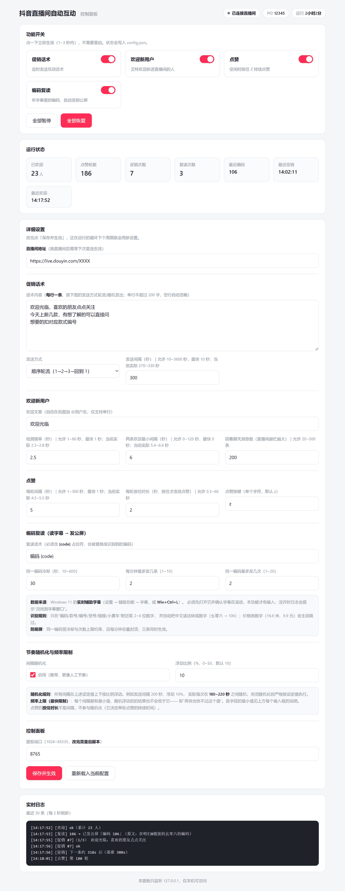

# douyinassis

在直播间帮你迎客、点赞、搞气氛、复读。

通过 Chrome DevTools Protocol 控制本机 Chrome，对抖音**网页版**直播间做四种自动化互动，并提供本地控制面板随时暂停、调参、看状态。

- 纯本机运行，不接入任何第三方服务，数据不出本机
- 参数集中在 `config.json`，面板里改了立即生效，不用重启
- 适配多台电脑：浏览器安装路径自动探测；配置目录默认取 Chrome 默认配置（登录态自动带上）

## 功能

| 循环 | 做什么 | 关键点 |
|------|--------|--------|
| **促销话术** | 按间隔发送互动文案 | 支持多行，每行一条，可选「顺序轮流」或「随机（不与上一条重复）」；发送失败不跳过 |
| **欢迎新用户** | 检测进入直播间的人，自动 `@用户名` 欢迎 | 每人只欢迎一次，可设最小间隔防刷屏 |
| **点赞** | 空闲时**按住** Z 键持续点赞 | 与发评论互斥，不抢输入框 |
| **编码复读** | 读 Windows 实时辅助字幕，听到主播报商品编码就发到公屏 | 中文数字归一化（幺零六 → 106）、价格类数字跳过、三重防刷屏 |

所有间隔都支持**随机浮动**（默认 ±10%），并各有**最快限制**（下限），避免机械节奏，也不会快过安全值。

## 环境要求

- Windows 10/11 + Chrome（Edge 亦可，脚本会自动回退；两者都用各自的默认配置目录，登录态不串）
- **浏览器版本**：不限。Chrome 136 起用默认配置目录会忽略调试端口，脚本已统一显式传 `--user-data-dir`，新旧版本都适用。
- **浏览器路径**：脚本会自动探测（注册表 App Paths → `Program Files` / `Program Files (x86)` / `%LOCALAPPDATA%`），**绝大多数情况不用配**。但如果你的 Chrome 是**绿色版 / 便携版 / 装在非 C 盘 / 自定义安装目录**，探测不到时需要在 `config.json` 里按**你自己电脑的实际路径**填写：

  ```json
  "browser": {
    "chrome_path": "D:\\ChromePortable\\chrome.exe",
    "user_data_dir": ""
  }
  ```

  不知道路径怎么查：Chrome 地址栏输入 `chrome://version`，「可执行文件」那一行就是。`user_data_dir` 一般留空——留空时脚本会按浏览器取默认配置目录并**显式传给浏览器**（注意：Chrome M136 起，不显式传这个参数会**静默忽略调试端口**，表现为"浏览器起来了但连不上"）。
- Python 3.8+（建议 3.10+），依赖：

```
pip install requests websocket-client
pip install uiautomation        # 仅「编码复读」需要
```

- **Python 选择**：脚本会自动挑选**装好依赖**的解释器，候选顺序为 `runtime.python_path` → PATH 里的 `python` / `python3` → `py -3` 启动器。以下情况会被自动跳过或处理：
  - PATH 里的 python 没装 `requests` → 跳过，继续试下一个
  - **Microsoft Store 的 python 别名占位符**（`...\WindowsApps\python.exe`，运行只会弹商店）→ 跳过
  - 只有 `py` 启动器、没有 `python` 命令 → 用 `py -3`
  - 全都不合格 → 明确报错并给出 `pip install` 命令，不静默失败
- 编码复读还依赖 **Windows 实时辅助字幕**（设置 → 辅助功能 → 字幕，或 `Win+Ctrl+L`）。用不了时其余三个循环照常工作。
- 抖音网页版需已登录（脚本用浏览器默认配置目录启动，登录态自然带上）

## 快速开始

1. 把本仓库文件放到同一个目录（例如 `D:\douyin`），或直接 `git clone`
2. 复制配置模板并填写直播间地址：

```
copy config.example.json config.json
```

3. 双击 `start.ps1`

   > `.ps1` 双击无反应是 PowerShell 执行策略限制：右键 →「使用 PowerShell 运行」，或先执行
   > `Set-ExecutionPolicy -Scope CurrentUser RemoteSigned`。

启动后会自动：带调试端口启动 Chrome → 打开直播间 → 拉起主程序 → 打开控制面板 `http://127.0.0.1:8765`。

停止：双击 `stop.ps1`（协作式退出，不扫描进程、不强杀）。

## 控制面板

打开 `http://127.0.0.1:8765`：



- 四个功能各一个开关，可独立暂停/恢复，1~3 秒生效
- 全部设置可在线修改并热生效（端口除外，需重启）
- 每个间隔输入框后面实时显示「允许范围 / 最快限制 / 按当前设定的实际浮动区间」
- 运行状态：连接状态、运行时长、已欢迎人数、点赞轮数、促销次数、复读次数与最近编码
- 最近 30 条日志

面板只监听 `127.0.0.1`，仅本机可访问；`panel.enabled=false` 可整体关闭。

## 配置

完整字段见 `config.example.json`，几个要点：

- `promo.message`：多行文本，**每行一条**话术；`promo.mode` 为 `sequential` 或 `random`
- `welcome.message`：仅单行（要与 `@用户名` 拼在一行）
- `jitter`：`enabled` 开关 + `ratio` 浮动比例（0~0.5）
- `code_echo`：`template` 必须含 `{code}`；`cooldown` / `per_minute` / `per_code` 为三重闸门
- `browser`：`chrome_path` 留空即自动探测；`user_data_dir` 留空则用 Chrome 默认配置目录，一般都不用填
- `runtime.python_path`：指定运行用的 Python（需已装 `requests`、`websocket-client`）；留空则由脚本按依赖自动挑选

## 编码复读是怎么做的

1. 从 Windows 实时辅助字幕窗口（`LiveCaptionsDesktopWindow`）读取文本控件 `CaptionsTextBlock`
2. 字幕文本是**整场累积**的，所以启用时先取当前长度作基线，只处理之后新增的部分（不补发历史）
3. 只在「编码 / 款号 / 编号 / 货号 / 链接 / 小黄车」附近取 2~6 位数字，中文读法逐位转换
4. 通过三重闸门 + 随机延迟后，用右下角输入框发到公屏

## 目录结构

```
run_loop.py            主程序：四个循环 + 控制面板服务
cdp_client.py          CDP 客户端（与主程序同目录）
panel.html             控制面板页面（与主程序同目录）
start.ps1 / stop.ps1   一键启动 / 停止
config.example.json    配置模板
diag_welcome.py        欢迎失效时的诊断脚本
skill/                 WorkBuddy 技能包源（SKILL.md + 参考文档 + 图标）
tools/build_skill.py   从根目录文件组装技能包 zip
```

## 常见问题

- **浏览器没打开 / 提示 CDP 失败**：多数是已有 Chrome 在跑但没开调试端口，脚本会给出提示与手动命令；也可在 `config.json` 的 `browser.chrome_path` 指定路径。
- **提示找不到 Chrome，或自动探测到的不是你常用那个**：按自己电脑的实际安装路径填 `browser.chrome_path`（`chrome://version` 里能查到），这是最容易因为「每台机器装的位置不一样」而出错的地方。
- **点赞没反应**：抖音网页版必须「按住」Z 才连续点赞，单击无效；脚本已处理播放器激活与按键参数。
- **编码复读不工作**：先确认实时辅助字幕已开启且在滚动，详见 troubleshooting 第 9 节。

更多排障见 [`skill/references/troubleshooting.md`](skill/references/troubleshooting.md)。

## 说明

- 本项目仅做常规人工互动的自动化（发话术、欢迎、点赞、复读编码），请遵守抖音平台规则并合理设置频率；因使用产生的账号风险由使用者自行承担。
- 不做任何数据上传；`config.json`、日志、锁文件等本地文件已被 `.gitignore` 排除。
- 页面 DOM 选择器随抖音改版可能失效，排障方法见 troubleshooting 文档。
